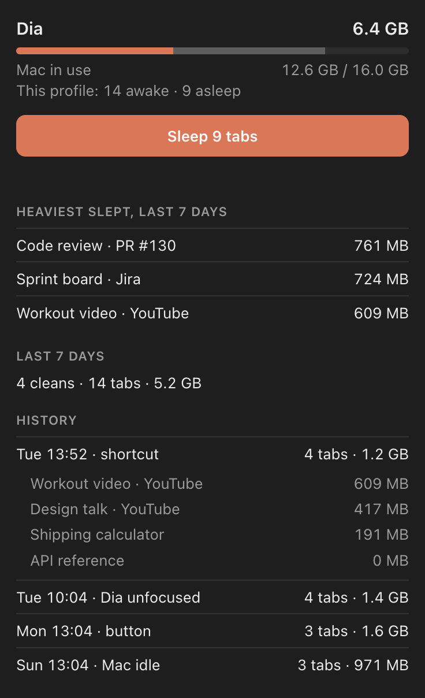
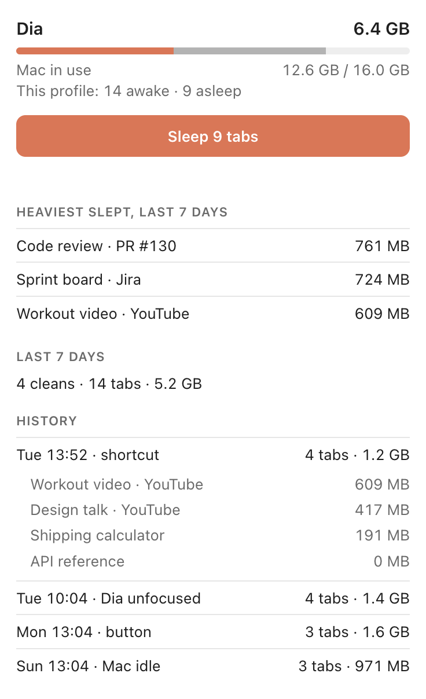

<p align="center"></p>

<h1 align="center">Sleep Old Tabs</h1>

Chromium extension (built for [Dia](https://www.diabrowser.com)) that unloads every tab except the most recent ones to free RAM.

- **Manual:** toolbar popup button or `⌥⇧S`.
- **Automatic:** after 5 min of Dia being unfocused or the Mac being idle.
- Keeps visible tabs, tabs playing audio and the 5 most recently used.
- Popup shows Dia's memory, sleep candidates, top freed tabs, weekly stats and per-clean history.

Freed memory is measured per tab: tabs are discarded one by one and the exited renderer processes are read by a small native host (`host/dia_mem.py`, uses `ps` and `top`). Without the host the extension still works, just without MB numbers.

<p align="center">
  
  
</p>
<p align="center"><sub>Popup with sample data. Expand a history row to see what each clean freed.</sub></p>

## Install

1. `chrome://extensions` → **Developer mode** → **Load unpacked** → this folder. Repeat per browser profile.
2. Copy the extension ID and register the host: `host/install.sh <extension-id>`.
3. Optional: set the shortcut at `chrome://extensions/shortcuts`.

The extension ID is derived from the folder path, so it is the same in every profile but changes if the folder moves.

## Check

```sh
node common.test.mjs
```
