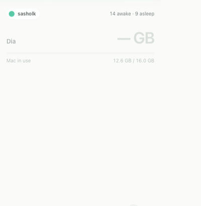
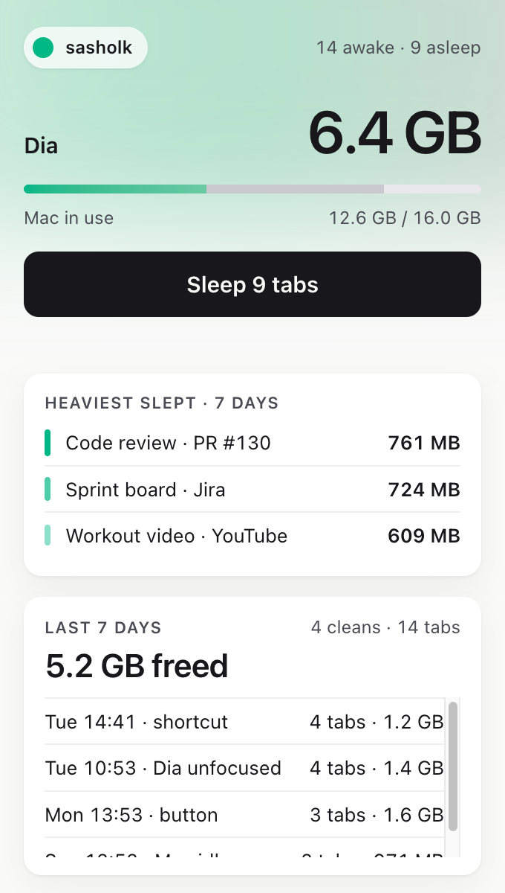
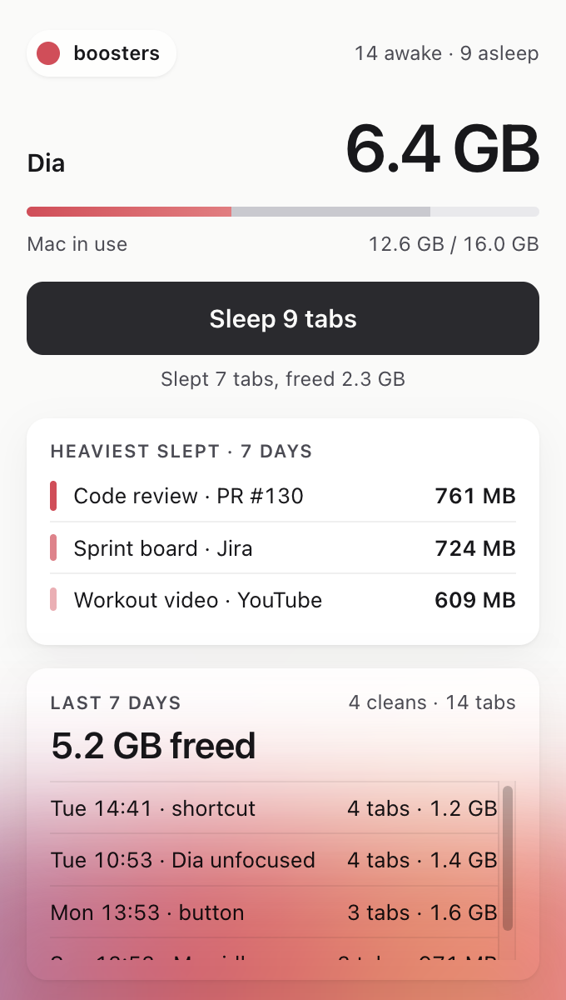
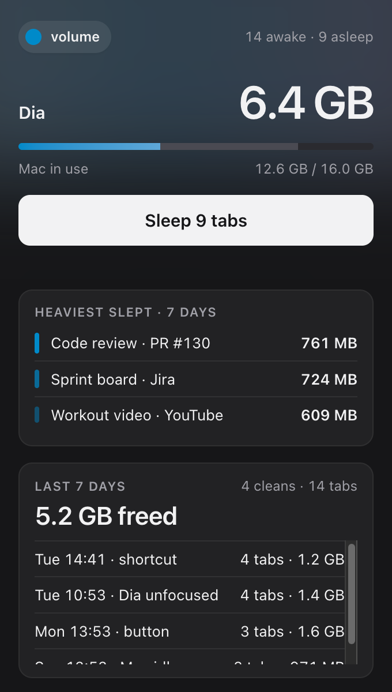

<p align="center"></p>

<h1 align="center">Sleep Old Tabs</h1>

Chromium extension (built for [Dia](https://www.diabrowser.com)) that unloads every tab except the most recent ones to free RAM.

- **Manual:** toolbar popup button or `⌥⇧S`.
- **Automatic:** after 5 min of Dia being unfocused or the Mac being idle.
- Keeps visible tabs, tabs playing audio and the 5 most recently used.
- Popup shows Dia's memory with a breakdown (this profile's tabs, other profiles, Dia itself, extensions, graphics, services), the heaviest tabs now or slept this week, weekly stats and per-clean history.
- Styled after Dia: the popup finds which Dia profile it runs in (via the native host) and takes that profile's name and theme color, light or dark to match macOS. If the profile can't be detected, you pick it once.

Freed memory is measured per tab: tabs are discarded one by one and the exited renderer processes are read by a small native host (`host/dia_mem.py`, uses `ps` and `top`). The same host powers the live "Heaviest tabs · Now" list: it matches each renderer's `--renderer-client-id` to the tab's `processId` from `webNavigation` (that permission shows as "read your browsing history" on install; nothing is stored or sent). Tabs sharing one renderer show as one row. Without the host the extension still works, just without MB numbers.

<p align="center"></p>

<p align="center">
  
  
  
</p>
<p align="center"><sub>Sample data. The popup takes the color of its Dia profile; after a clean the top glow travels down and lands as an aurora.</sub></p>

## Install

1. `chrome://extensions` → **Developer mode** → **Load unpacked** → this folder. Repeat per browser profile.
2. Copy the extension ID and register the host: `host/install.sh <extension-id>`.
3. Optional: set the shortcut at `chrome://extensions/shortcuts`.

The extension ID is derived from the folder path, so it is the same in every profile but changes if the folder moves.

## Check

```sh
node common.test.mjs
```
